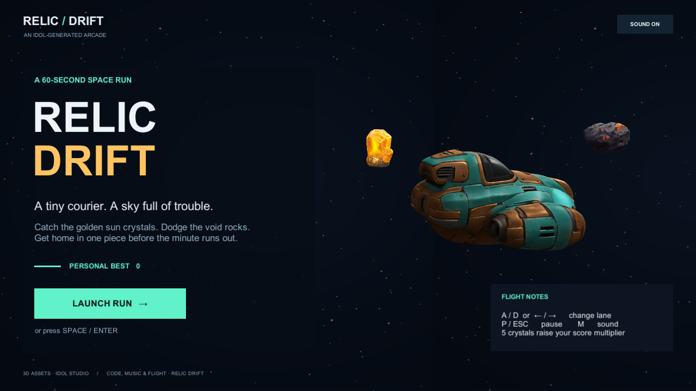
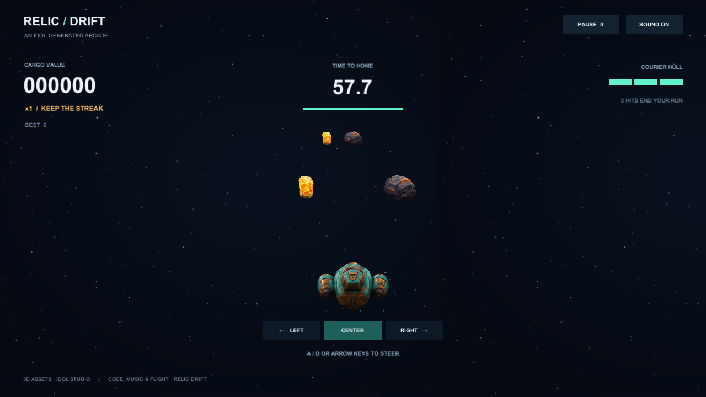

# Relic Drift

A small Unity arcade game made with **Idol-generated 3D assets only**. Pilot a teal-and-brass courier through three lanes, collect amber sun crystals, dodge void rocks, and survive a 60-second delivery.

**Every visible 3D object was created with [Idol Studio](https://github.com/shohdi/idol-csharp), using the [Speridlabs Idol model](https://huggingface.co/speridlabs/idol).** No 3D assets were downloaded, hand-modeled, generated as primitive meshes, or made in Blender. The game displays the original Gaussian splats directly. The star backdrop and interface are 2D graphics; music and sound effects are synthesized by C# code.





## Play

Download the Windows ZIP from [Releases](https://github.com/shohdi/idol-relic-drift/releases), extract the entire folder, and run `RelicDrift.exe`. Keep `UnityPlayer.dll` and the `RelicDrift_Data` folder beside it. Playing requires no Unity installation, Python, Idol installation, model weights, Hugging Face account, or internet connection.

| Control | Action |
| --- | --- |
| A / D or Left / Right | Change lane |
| Mouse: lane buttons | Change lane |
| Space / Enter | Start or restart |
| P / Escape | Pause or resume |
| M | Toggle sound |
| F11 | Toggle fullscreen |

Collecting a crystal earns 100 points times your current multiplier. Every five consecutive crystals raises the multiplier, up to ×5. A rock removes one of three shields and resets the streak. Finish the minute to complete the delivery; your best score is saved locally.

## Open in Unity

1. Clone this repository.
2. In Unity Hub choose **Add project from disk** and select its folder.
3. Open with **Unity 6000.2.6f1** and Windows Build Support (Mono).
4. Open `Assets/Game/Scenes/RelicDrift.unity` and press Play. If the scene needs rebuilding, choose **Relic Drift → 1. Set up game**.

The three `.idolply` source assets and their AI source PNGs are included. The custom importer creates Unity data assets automatically. The minimal project uses the Built-in Render Pipeline and Direct3D 11.

From Command Prompt on a machine with Unity installed:

```cmd
cd /d C:\path\to\idol-relic-drift
powershell -ExecutionPolicy Bypass -File .\Tools\Build.ps1
Builds\Windows\RelicDrift.exe
```

`Build.ps1` accepts `-EditorPath` or the `UNITY_EDITOR` environment variable if Unity is installed elsewhere. Close this project's Editor before a command-line build.

## How it was created

1. Create three isolated transparent PNGs with the built-in OpenAI image-generation tool: courier, sun crystal, and void rock.
2. Feed each PNG into the **unchanged C# Idol Studio pipeline**, using synthetic mode, 50 steps, guidance 3, time shift 3, and recorded seeds.
3. Save the resulting original 3D Gaussian splats as standard binary PLY, with a `.idolply` extension for Unity's custom importer.
4. Assemble and animate those assets through C# transforms. Gameplay uses lane/distance checks, so it needs no hand-made collision mesh or visible primitive geometry.
5. Add a C# interface, procedural 2D star texture, and original synthesized music/sounds.
6. Build and test the actual Windows player.

| 3D asset | Idol Gaussian count | Seed | Use |
| --- | ---: | ---: | --- |
| Courier | 65,536 | 1042 | Player craft and title display |
| Sun crystal | 32,768 | 2042 | Collectibles |
| Void rock | 32,768 | 3042 | Obstacles |

Full instructions, exact image prompts, restrictions, and reproduction steps are in **[Docs/CREATION.md](Docs/CREATION.md)**. Each asset has a [provenance JSON record](Docs/Provenance) containing image/output hashes, Idol version, settings and count. [Docs/VALIDATION.md](Docs/VALIDATION.md) records the checks actually run.

## Project layout

- `Assets/Game/Scripts`: rules, movement, pooling, interface and original audio.
- `Assets/Game/Validation`: development-player gameplay and asset checks.
- `Assets/Game/Art/Sources`: the three AI-generated PNG inputs.
- `Assets/Game/Art/Splats`: the three original Idol-generated 3DGS PLY outputs.
- `Assets/Idol`: importer, asset format and full-density Gaussian renderer adapted from Idol Studio.
- `Assets/Game/Editor`: scene setup, asset audit and Windows build automation.
- `Tools/AssetGenerator`: offline C# batch generator calling already-built Idol Studio assemblies; it never builds or edits the Idol Studio repository.

## Checks

```powershell
./Tools/Run-Checks.ps1
./Tools/Verify-Provenance.ps1
```

This builds a development player, verifies real spawned pickup/obstacle interactions and state transitions, captures title/gameplay screenshots, audits that world visuals use Idol splats, and restores any existing local preferences afterward. No checks download 3D assets or use external credentials.

The renderer preserves every Gaussian, shares GPU buffers by asset, and caches depth ordering. Overlapping Gaussian objects are ordered by their centers; this is intended for spatially separated lane actors rather than intersecting transparent sculptures. A graphics API with structured buffers is required. General model-generation quality and exact parity with the upstream Python SDK are not claimed.

Authored code is Apache-2.0; see [LICENSE](LICENSE) and [NOTICE](NOTICE). Unity and the upstream model/runtime components retain their own terms. No model weights, credentials, or Unity Editor files are redistributed here.
